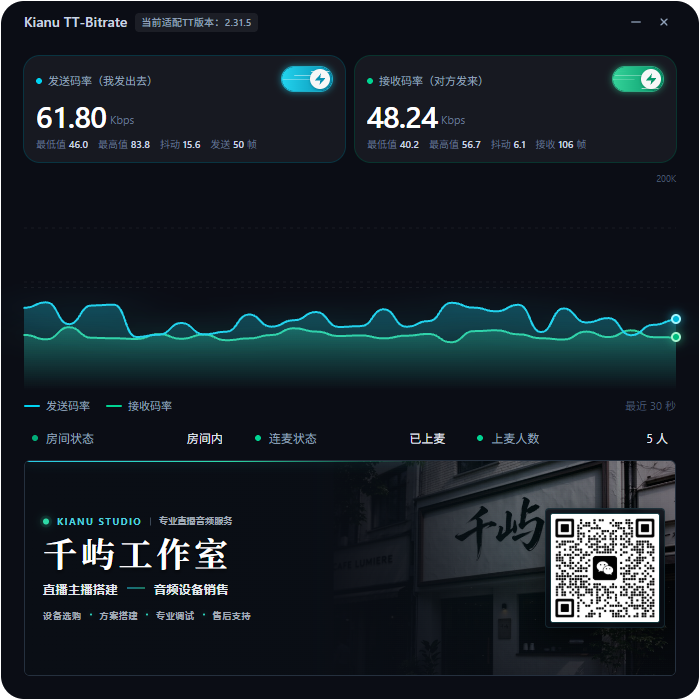

# Kianu-TT-Bitrate

TT 语音双向码率悬浮窗工具（Windows 64 位单文件 exe）。

本仓库为**发布仓，只发成品，不开源**。右侧 `Releases` 下载 exe 即用，不需要装任何开发环境。

## 一句话介绍

实时显示 TT 语音房里的**发送码率（我发出去）**和**接收码率（对方发来）**，带 30 秒走势图，一键开 192K 高码率模式。


## 下载

1. 点本页面右侧 `Releases` → 最新版本
2. 下载 `Kianu TT-Bitrate.exe`（单个文件，绿色免安装）
3. 放任意目录即可，建议不要放 `Program Files` 下

## 运行环境

- Windows 10 / 11，64 位
- **必须以管理员身份运行**（右键 → 以管理员身份运行）
- 需要本机装有 Microsoft Edge WebView2 运行时（Win10 / Win11 一般自带，缺失会弹窗报错）
- 当前适配 **TT 语音 2.31.5**（ZEGO 引擎 3.25.0.52036）

> 原理：跨进程读取 TT 语音内存中的 ZEGO 引擎状态，码率采集本身是只读的。
> 只有你手动打开高码率开关时，才会向 TT 下发一次音频编码配置。

## 快速上手

1. 先开 TT 语音，并**先进一个语音房间**
2. 再以管理员身份运行 `Kianu TT-Bitrate.exe`
3. 悬浮窗自动居中弹出，开始显示实时码率
4. 需要高音质：打开左上角发送卡片上的高码率开关

顺序反了（先开工具、后进房）也能用，进房后数据会自动出来。

## 界面说明

悬浮窗固定大小（640×560），透明无边框，可按住顶部标题栏拖动，右上角最小化 / 关闭。

### 发送码率（青色，我发出去）

- 大数字：实测发送码率，单位 Kbps
- 最低值 / 最高值：最近 30 秒窗口内的谷值和峰值
- 抖动：相邻采样点变化量的均方根，越大说明码率越不稳定，超过 20 变黄提示
- 发送帧：当前发送帧率
- 右上角开关：高码率模式

### 接收码率（绿色，对方发来）

- 大数字：对方发过来的总码率，已剔除自己回听
- 开关关掉后显示 `--`，曲线也不画，纯省干扰看发送用
- 其余最低值 / 最高值 / 抖动 / 接收帧含义同发送

### 中部走势图

- 青色线 = 发送，绿色线 = 接收
- 最近 30 秒，每秒一个点
- 纵轴自适应：平时上限 200K，高码率下自动放大到 400K
- 鼠标悬停可看“几秒前的数据 + 当时双向码率”

### 底部三状态

- 房间状态：在房间内 / 在房间外
- 连麦状态：已上麦（正在发送音频）/ 未上麦
- 上麦人数：房间里有音频流的用户数，不含自己

### 底部广告位

千屿工作室宣传横幅，扫码联系设备选购 / 方案搭建 / 专业调试 / 售后支持。

## 高码率模式（48K → 192K）

发送卡片上的开关，作用：

- 开：把 TT 的音频编码码率改成 **192Kbps**
- 关：恢复成 TT 原本的码率（一般是 48Kbps）

几个行为要知道：

1. 进房瞬间 TT 会把配置重置回默认，所以开着开关进新房会自动补发一次 192K
2. 开关状态会记住，下次启动自动恢复（存放在 `%LOCALAPPDATA%\KianuTTBitrate\settings.json`）
3. 退出房间时开关不会自己关，下次进房继续生效
4. 如果切到不支持的 TT 版本导致程序阻断，TT 里的码率可能还停在 192K，重启 TT 语音即恢复默认

## TT 版本不匹配（全屏提示）

本工具依赖特定 TT 版本的内存偏移，版本对不上时读到的全是错数，所以会直接全屏阻断，只留一个“退出程序”按钮。



遇到时：

1. 看弹窗左侧“当前版本” vs 右侧“适配版本”
2. 扫码联系（微信号 `fenderstudiopro`）免费拿适配新版的程序
3. 之前开过 192K 的话，重启一次 TT 语音即可恢复默认码率

## 命令行诊断（进阶）

exe 除正常双击外，还有三个调试模式，均需管理员权限，在 exe 所在目录开终端运行：

```powershell
# 只读诊断：TT 进程、ZEGO 基址、房间表、收发流数量、编码配置，全程不写内存
.\Kianu TT-Bitrate.exe --probe

# 自检：TT 一升级先跑这个，6 项逐项检查偏移和写入链路是否还对得上
.\Kianu TT-Bitrate.exe --selftest

# 写入测试：把编码码率改成指定值再读回来验证，会写 TT 配置
.\Kianu TT-Bitrate.exe --set-rate 192
